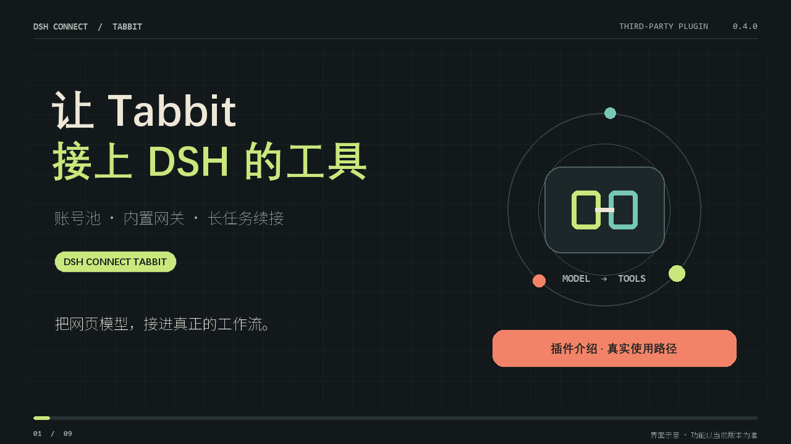

# DSH Connect Tabbit

> **Turn your Tabbit browser quota into a free local model gateway for DeepSeek Harness — CN & Global editions, 20+ models, zero setup.**
> 把 Tabbit 浏览器的模型额度变成 DeepSeek Harness 的内置网关：国内版 + 国际版、20+ 模型、Token 统计、每日签到、长任务续接。

[](promo/bilibili-intro/dsh-connect-tabbit-intro.mp4)

   

## 快速开始（三步）

1. **安装**：在 DSH 桌面版的插件市场或 `dsh plugin --profile desktop add` 安装本插件（或从本仓库 clone 后链接）。
2. **登录 / 导入**：DSH → 设置 → 插件配置 → dsh-connect-tabbit → 登录 Tabbit（选国内版 / 国际版），或导入本机浏览器登录态。国际版三步指南见 [docs/global-edition-setup.md](docs/global-edition-setup.md)。
3. **选模型开聊**：模型选择器里选 `tabbit-cn`（23 模型）或 `tabbit-global`（34 模型）区域的任意模型，直接对话与工具调用。

无需 Python / Docker / 独立常驻网关：内置网关随插件启停，只监听本机回环随机端口，账号保存在 `~/.dsh/plugins/dsh-connect-tabbit/accounts.json`（0600 / 用户 ACL）。

## 目录

| 章节 | 内容 |
|---|---|
| [登录与账号池](#登录与账号池) | 隔离登录窗口、Cookie / JWT 导入、多账号池 |
| [对话与工具](#对话与工具) | 工具调用协议、CDATA 信封、四道防线 |
| [长任务](#长任务) | 流保活、事件续接、有界修正 |
| [额度与消耗](#额度与消耗) | 官方计数 vs 本地估算、模型倍率、每日签到 |
| [架构与兼容](#架构与兼容) | 进程内网关、外部模式、安全边界 |
| [国际版上手](docs/global-edition-setup.md) | 浏览器安装、双登录路径、验证记录 |
| [接口证据](docs/tabbit-api-evidence.md) | 真实账号验证记录 |

**2026-10-24 实测记录**：76/76 单元测试通过；国内版全链路真实补全通过（网关→shim→DSH 适配器，23 模型 / 1 账号）；**国际版全链路真实补全通过**（34 模型 / 1 账号，浏览器登录态导入→账号池→网关→shim→适配器）；**真实工具调用往返双版本一次通过**（glm-5-3-flashx 含引号代码参数保真，未触发修正循环）；每日签到真实领取成功并二次确认（详见 [国际版上手](docs/global-edition-setup.md)）。

插件内置网关，随 DSH 自动启动、随插件关闭，无需安装 Python / Docker，也不需要手动运行 8800 / 8801 服务。国内版与国际版使用独立的账号池、随机本机端口和随机密钥。国际版需要独立的国际版账号，国内版登录态不能通用。

## 登录与账号池

- **登录 Tabbit**：在隔离的官方登录窗口中完成登录，插件自动保存账号，支持取消和超时处理。
- **导入本机已登录账号**：Windows 下读取对应版本 Tabbit 浏览器的登录 Cookie。文件被浏览器占用时，可退出 Tabbit 后导入或使用登录按钮。
- **导入账号 / 文件**：支持 JWT、`jwt|nextauth|device_id`、Cookie、浏览器 Cookie 数组和账号 JSON。先校验整批，再原子保存；重新导入同一账号时更新登录态并保留已有启用和签到状态。

账号持久保存在 `~/.dsh/plugins/dsh-connect-tabbit/accounts.json`。内置网关只在内存中保留执行副本，重启后从本地账号池恢复。POSIX 文件权限为 `0600`，Windows 使用当前用户目录的 ACL。

## 对话与工具

原样保留 DSH 消息角色、用户标签、工具定义、调用 ID 和执行结果。模型生成的工具请求通过白名单校验后转为 OpenAI `tool_calls`，交给 DSH 执行。网关本身不打开浏览器，也不会把模型的文字当作已执行成功。

Tabbit 官方输入框限制单次文本为 20,000 字符。旧外部网关把历史和全部工具拼成一条消息，约 30 万字符的请求会触发上游 492，并返回“欢迎使用 Tabbit 浏览器”。

内置网关对超过 18,000 字符的请求自动使用官方文档附件流程：完整上下文作为文本附件发送给同一个 Tabbit 账号，正文保留当前用户请求、最近工具结果及协议说明。不会为避开限制删掉用户消息或工具定义。附件会作为该账号在 Tabbit 中的会话资料保留，和网页上传文件的行为相同。

工具调用属于网页模型的文本协议兼容，仍受模型能力和 Tabbit 服务限制影响。上游拒绝、无正文、无完成事件或无效工具调用会明确报错；492 与工具格式问题不会使有效账号进入冷却。

0.4.0 增加代码专用的多行字符串协议：代码内容原样置于 CDATA 中，参数名称、必填项和字符串类型仍按工具定义校验，避免 Python / PowerShell / Windows 路径反复嵌套 JSON 转义。普通 JSON 调用继续兼容。Windows 上优先写源码文件再运行，不将多行程序塞进 `python -c`。

官方返回的 `thinking.reasoning_content` 实时转发到 DSH 推理过程；模型另外用简短 `dsh_progress` 更新当前步骤，正文中的进度不再等到整段工具参数生成完成才显示。没有返回的推理不会编造或由网关推算。

继续任务时会回溯实际用户目标；时间、技能清单、梁神模式的 `[Working Context: ...]` 都作为环境信息。压缩检查点只在原始请求已经离开可见历史时用于恢复背景，压缩后重新投射的进行中待办仍用于判断是否需要继续。

## 长任务

0.4.2 修复内置网关把所有模型上下文写死为 100K 的问题。优先读取官方明确的上下文字段，其次读取模型说明中的明确长度；没有声明时保守使用 100K。当前国内版目录明确声明 1M 的包括 Kimi-K3、DeepSeek-V4.1-Flash、MiMo-V2.6-Pro / Flash、LongCat-2.0。设置中的每个模型显示长度，悬浮说明区分官方标称、保守默认和外部网关声明。

上下文长度用于 DSH 判断何时压缩历史，不会被误传为最大输出长度。官方未公布长度的 GLM-5.3-FlashX 等模型不按其他厂商版本猜测容量。模型标称长度、网页单条输入限制、附件处理能力是不同限制；上传完整文件不代表服务端一定会将全部内容放入模型上下文，也不能突破模型本身的容量。自动压缩及任务检查点仍用于跨窗口的长任务。

- 单次生成不再使用固定 3 分钟连接总超时。当前为 45 秒建连、90 秒无网络数据后续接、单次生成最多 20 分钟；多轮工具任务可以跨越多个生成轮次。DSH 语义流看门狗为 25 分钟，避免在工具 JSON 缓冲期间提前打断。
- 内置网关每 10 秒发送 SSE 保活；v3 短暂断流按最近 `event_id` 续接同一个任务，最多续接 6 次并退避、去重。提交回执丢失时只加入原房间确认，不盲目重复创建生成任务。
- 上游不提供事件编号、事件已重置或重试预算耗尽时明确失败，不将不完整结果标为完成。用户取消时关闭流并尽力发送官方取消命令。
- 强调当前请求、最近结果与未完成步骤；缓冲的工具参数出错时在限定预算内修正格式，通过校验后才交给主机执行。
- DSH 的 `purpose: compaction` 请求关闭本轮工具定义，摘要中的历史调用标签只作为文字，避免压缩误触工具协议。其他工具会话保留原有工具。
- 用户只说“继续”时恢复前一个真实目标，长任务预览同时保留开头与交付要求的结尾。根据当前目标下已成功写入的 `todo_write` / `update_plan` 检查未完成项，避免将“环境已就绪，下一步写代码”当成最终完成。纯状态问题、新任务以及明确需要用户输入的阻塞状态仍可正常结束。
- 工具格式最多修正两次，未完成状态最多续接两次，单个请求总预算仍为 20 分钟。达到上限会明确报错，不无限自循环，也不将未完成任务显示为成功。

0.4.1 根据真实会话中“只说接下来写文件却正常结束”的记录修复：即使压缩后没有待办投射，明确的下一步执行承诺或只有进度标签也会进入有界续接。已经验证的结果报告、状态问题和可选后续建议仍可正常结束。不能仅靠此判断保证所有模型完成任意任务。

历史回复中的推理字段不再重新拼进 Tabbit 请求附件；用户消息、公开回复、工具调用 ID、完整参数与执行结果保持不变，DSH 已展示和保存的原始推理也不修改。摘要调用通过系统标记传递 `purpose: compaction`，使用独立的仅摘要提示，不再混入继续执行原任务的指令。

网关日志和最近用量记录增加请求用途、结束类型、工具调用数、任务状态、未完成数和修正次数，便于排查停止位置；不记录消息、推理正文、代码或凭据。

这些措施不能消除账号过期、额度耗尽或 Tabbit 停服。错误不会因普通断流或格式问题把有效账号误判为失效。

## 额度与消耗

显示官方会员等级、周期已用 / 剩余百分比、重置周期、各模型 `display_multiplier`。倍率描述相对额度消耗，不是人民币单价。

设置卡片单独显示输入 / 输出 / 累计 Token、官方计数与本地估算、最近请求、进行中和续接次数。卡片展开时每 5 秒刷新本机统计，不重复请求官方额度。计数记录在 `~/.dsh/plugins/dsh-connect-tabbit/token-usage-tabbit-cn.json`（国际版另存）并在重启后保留，只记录计数和模型等元数据，不保存正文或凭据。

只有实际收到官方 `usage` 才写入标准 OpenAI 用量字段；暂无官方计数时按中日韩字符与其他文本长度估算，明确标记 `estimated`。估算包含完整附件文本、实际回传的推理与正文、重试和失败请求，不包含未回传的隐藏推理、图片或服务端附加 Token，不能代表真实扣费。网关另用 `dsh_usage` 字段提供本轮统计来源；估算不注入 DSH 的货币费用账本。

每日签到使用官方 `desktop_pet` 活动与服务端日期，并确认服务端签到结果。

## 架构与兼容

```text
DSH 模型适配器
  → 私有本机 shim
    → 插件内置 OpenAI 网关（同一个 DSH 进程）
      → Tabbit 官方会话、v3 任务流、文档附件

本地账号池 → 内存执行副本
设置卡片   → 官方额度、模型倍率、签到
```

服务只绑定 `127.0.0.1` 随机端口，账号与代理接口需要进程内随机密钥；关闭插件会中止请求并释放监听。安装包包含服务实现，不下载运行时或代码，不启动额外常驻进程。

默认 `gatewayMode: auto` 自动运行内置网关。已有非默认自定义 URL 的旧配置在 auto 模式保留外部模式；`embedded` 可强制使用内置服务。希望继续使用独立 tabbit2api 时，在对应版本配置中显式指定：

```yaml
cn:
  enabled: true
  gatewayMode: external
  gatewayUrl: http://127.0.0.1:8800
  adminPassword: admin
```

外部模式仍将账号同步到该服务，服务按自己的配置持久保存执行副本。连接模式更改后需要重新加载插件或重启 DSH。两种模式均支持官方地址覆盖 `tabbitUrl`，通常保持默认即可。

## 安装与验证

将插件安装到 DSH 后重启，在账号卡片登录。支持 Node 22.19+ 或 24+ 的 DSH 运行环境；模型适配器使用 DSH 提供的 peer dependencies。

`npm test` 使用模拟服务验证登录、原子导入、额度、界面、工具协议、区域隔离、附件上传与停止清理，不需要真实账号。

真实账号验证记录见 [接口证据](docs/tabbit-api-evidence.md)。当前已验证国内版默认模型与 GLM-5.3-FlashX 工具往返，包含 95 个合成工具与超长历史；工具执行结果为模拟值。国际版已于 2026-10-24 完成真实账号全链路验证（浏览器登录导入→账号池→网关→shim→DSH 适配器，34 模型，见 [国际版上手](docs/global-edition-setup.md)）。

补充真实界面回归：在 DSH 的“Tabbit插件回归测试”会话中，由 GLM 实际调用 `computer_observe` 打开 B 站，再通过 `pwsh` 启动本机 Edge、记事本和计算器，并从真实工具结果核验窗口标题。此次不是模拟工具。0.2.1 另修复 Agent Loop 预备调用入口绕过未知用量过滤的问题。

协议参考：[tabbit2api](https://github.com/hoinata/tabbit2api)。内置服务由本插件的 `lib/embedded/` 实现，不依赖该 Python 服务。
## 本机稳定性修复（2026-10-24）

- 原任务识别排除 DSH 的 `[Circuit Breaker]` 运行时提示，防止防循环消息覆盖用户目标；该提示仍完整传给模型，防循环和用户取消机制不变。
- 超长附件的最近对话预览跳过技能目录、工具目录等环境消息，让最近的工具结果能够直接呈现；完整请求附件不删除这些消息。
- 串流按任务编号过滤后再去重，避免其他任务的事件污染当前任务游标；事件编号 0 也可以正常续接。
- 自动格式修正和续接仍有上限。账号过期、额度不足、上游停服不能承诺永不中断，也不会伪造成功。
- 修复验证和真实模型工具测试记录位于 `E:/op2025/output/tabbit-stability-20261024/`。
